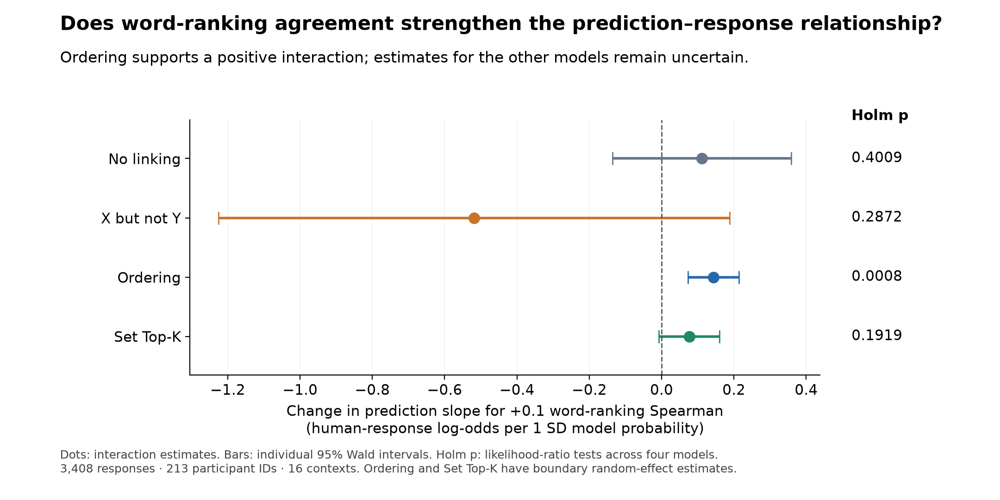
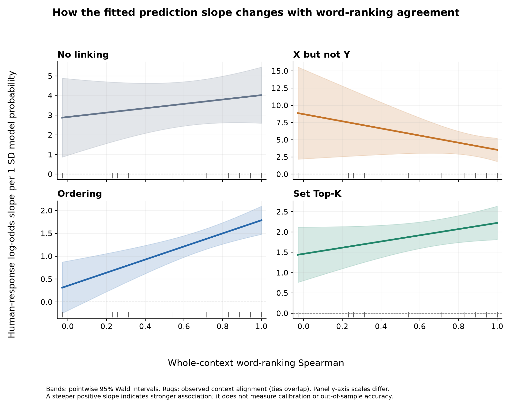

# Does word-ranking agreement moderate model–human negation association?

## Conclusion

The exploratory analysis supports the proposed positive interaction for **Ordering**. Its model-predicted exclusion probability has a stronger positive association with human exclusion responses in contexts with higher human–model word-ranking agreement. No linking and Set Top-K have positive but uncertain interaction estimates. X but not Y has a negative but uncertain estimate. The results therefore do not establish the hypothesis across all four models.

## Data and specification

This analysis uses only the novel-focus study in the corrected September 15 result bundle: **3,408 binary responses, 213 participant IDs, 16 contexts, and 480 ordered trigger–query pairs**. All responses and contexts are retained. The `id` column is treated as participant: each ID occurs once in every context. Source counts and human response rates were verified against the saved pair-level results.

For each model separately, the dependent variable is the participant's exclusion response (`neg`, 0/1). The predictor is the saved model-predicted exclusion probability. The moderator is the context's Spearman correlation between the six reference human word ranks and the corrected neutral Qwen word ranks. Reference human ranks come from `trigger_relevance`; they are not ranks computed from the exclusion outcomes. The same word-ranking agreement measure is used for all four models, including X but not Y.

The binomial logistic mixed-effects model is:

```r
neg ~ prediction_z * alignment_c +
      (1 + prediction_z || participant) +
      (1 + prediction_z || context) +
      (1 | item)
```

`item` identifies an ordered trigger–query pair within a context. Participant and context random intercepts and uncorrelated prediction slopes allow response tendencies and associations to vary; pair intercepts account for repeated responses to a pair. Probability is centered and divided by its SD across the 480 pairs, separately for each model. Alignment is centered at 0.698423. This scaling preserves the requested linear interaction; the predictor is **probability**, not its logit or the language model's next-word logits. See `scaling.csv` for all constants.

Unlike the earlier equally weighted correlations across pair-level response rates, this analysis uses individual responses. Pairs with more participant responses contribute more observations. Saved held-out predictions and boundary choices are preserved; the new regression itself is fit to all these responses.

## Primary results

Interaction coefficients below express the change in the human-response log-odds slope per **one SD of model probability and a +1 increase in word-ranking Spearman**. Positive values match the directional hypothesis. Confidence intervals are individual approximate Wald intervals. P values use a two-sided likelihood-ratio comparison with the same random effects and no interaction; Holm adjustment covers the four tests.

| Model | Interaction | 95% CI | Raw p | Holm p |
|---|---:|---:|---:|---:|
| No linking | 1.112 | [-1.364, 3.589] | 0.40094 | 0.40094 |
| X but not Y | -5.182 | [-12.252, 1.887] | 0.14360 | 0.28720 |
| Ordering | 1.433 | [0.730, 2.136] | 0.00020 | 0.00081 |
| Set Top-K | 0.761 | [-0.079, 1.601] | 0.06396 | 0.19187 |

For Ordering, at the 25th percentile of alignment (ρ=0.486), the fitted probability slope is 1.05 log-odds per SD (95% CI 0.78–1.32). At the 75th percentile (ρ=0.943), it is 1.71 (1.42–1.99). These are fitted slopes at the observed alignment quartiles, not separate regressions on high- and low-agreement subsets.

The figure rescales interaction estimates to a **+0.1** increase in agreement for readability.





## Fit checks and sensitivity

All primary optimizers returned status 0. No linking and X but not Y have nonsingular primary fits with satisfactory gradient checks. Ordering's full fit estimates both participant and context prediction-slope variances at zero; Set Top-K's full fit estimates the context prediction-slope variance near zero. These are singular (boundary) fits. Alternative optimizers reproduced their likelihoods. Derivative diagnostics were unavailable for the boundary fits in this lme4 version, so optimizer agreement is reported separately from derivative-based checks. See each model's `diagnostics.json`.

Removing only the zero-variance slope components from each full model, and fitting its no-interaction comparator with the identical simplified random effects, gives:

- **Ordering:** interaction 1.433, 95% CI [0.697, 2.168], unadjusted likelihood-ratio p=0.00010.
- **Set Top-K:** interaction 0.761, 95% CI [-0.034, 1.556], unadjusted likelihood-ratio p=0.06402.

These are sensitivity analyses, not replacements selected by significance. Singular fits can complicate inference; see the official [lme4 singularity documentation](https://lme4.github.io/lme4/reference/isSingular.html) and [convergence guidance](https://lme4.github.io/lme4/reference/convergence.html).

After inspecting primary fits, we also omitted each context in turn and refit the primary full formula, retaining the original scaling constants. This checks whether a single context determines the direction of the interaction. It conditions on the original saved predictions; it does not rerun boundary selection or constitute held-out validation.

| Model | Smallest interaction | Largest interaction | Individual 95% CI above zero |
|---|---:|---:|---:|
| No linking | -0.500 (omit cold) | 1.847 (omit meat) | 0/16 |
| X but not Y | -7.015 (omit restaurant) | -0.279 (omit meat) | 0/16 |
| Ordering | 1.293 (omit meat) | 1.622 (omit science) | 16/16 |
| Set Top-K | 0.561 (omit fridge) | 0.982 (omit transport) | 2/16 |

Intervals in this diagnostic are unadjusted and correlated across omissions; their counts are descriptive, not additional hypothesis tests. All selected omission fits returned optimizer status 0 with no remaining non-boundary convergence messages. The No linking fit omitting cut required restarting optimization from an earlier solution to pass gradient checks; all attempts are retained. Full coefficients, flags and optimizer diagnostics are saved in `leave_one_context_out.csv` and each model's diagnostic files.

## What this establishes, and what remains open

- **Supported interpretation:** for Ordering, higher whole-context word-ranking agreement is associated with a stronger positive relationship between predicted exclusion probability and human exclusion responses under this specification.
- **Other models:** the intervals do not establish the direction of moderation. An uncertain interaction does not establish no interaction, and it does not mean the model fails to predict exclusion.
- **Only 16 contexts:** the moderator varies across 16 contexts, even though the dataset contains 3,408 responses. Random context slopes allow between-context slope variation, but the Ordering estimate is on a variance boundary. The asymptotic intervals and p values should be treated as exploratory evidence and checked in additional contexts.
- **Meaning of “better”:** the interaction tests a conditional log-odds association after fitting a regression. It does not directly test higher Pearson/Spearman correlation, better calibration, or better prediction on new responses. Those require separate outcome measures and validation.
- **No causal claim:** agreement was not experimentally manipulated. Other context properties may explain its relationship with model fit. Uncertainty in reference ranks, finite model sampling, and boundary selection is not propagated.
- **No ranking of models from these p values:** all four regressions use the same responses, and their probability SDs differ. A significant interaction in one model and an uncertain interaction in another is not a formal test of their difference.

## Suggested wording for advisors

> In an exploratory participant-level logistic mixed-effects analysis of the novel-focus study, the association between Ordering's exclusion predictions and human exclusion responses became stronger as human–model word-ranking agreement increased. The interaction remained positive when each context was omitted in turn. The corresponding interactions for No linking, X but not Y, and Set Top-K were uncertain. These findings support an alignment-dependent association for Ordering, but do not establish that this pattern holds across linking structures or that improved alignment causes better predictive accuracy.

## Reproduce and inspect

From the repository root, with Python's numpy, pandas and matplotlib and R's lme4 and jsonlite installed:

```sh
python focus_alt_exp_pipeline/code/prepare_alignment_moderation.py
Rscript focus_alt_exp_pipeline/code/fit_alignment_moderation.R focus_alt_exp_pipeline/results/set_variant_qwen_corrected_2026-09-15/advisor_summary/alignment_moderation no_linking x_but_not_y ordering set_top_k
Rscript focus_alt_exp_pipeline/code/fit_alignment_moderation.R focus_alt_exp_pipeline/results/set_variant_qwen_corrected_2026-09-15/advisor_summary/alignment_moderation no_linking x_but_not_y ordering set_top_k --sensitivity
python focus_alt_exp_pipeline/code/summarize_alignment_moderation.py
```

The preparation audit records input hashes and join checks. Per-model folders contain fitted R objects, fixed and random effects, summaries, optimizer diagnostics and R session information. The original analysis plan is in `ANALYSIS_PLAN.md`. Estimation uses [lme4 glmer](https://lme4.github.io/lme4/reference/glmer.html) with a logit link and Laplace approximation. This run used R 4.6.0 and lme4 2.0-6; R reported that the package binary was built under R 4.6.1. A custom library can be supplied through `FOCUS_R_LIBRARY`.
