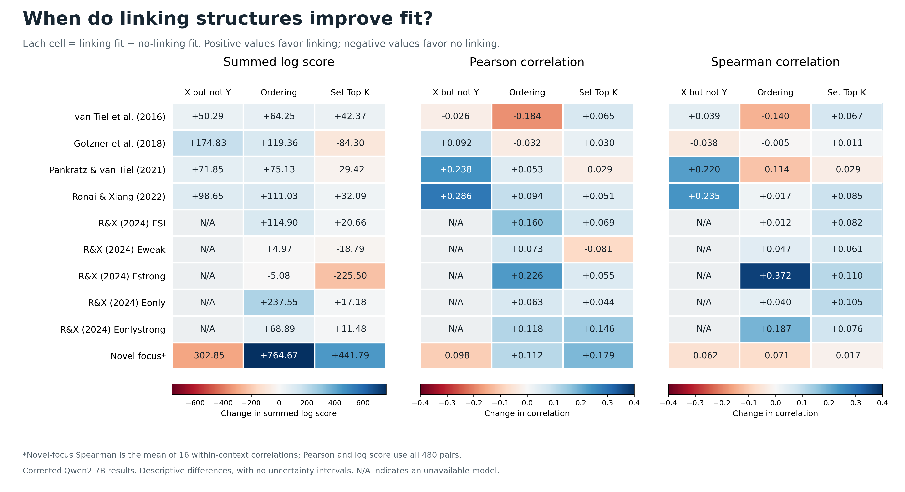

# When do linking structures improve on no linking?

## Scope and method

Log-score summaries and differences now sum item scores without division by
item count. Individual-pair examples remain individual scores. Original fitted
predictions and training boundary selection are unchanged.

This investigation uses the completed corrected single-space Qwen2-7B run.
The primary comparison includes the three structures selected for the advisor
plots: X but not Y, Ordering, and Set Top-K. Other evaluated structures are
examined separately below. A positive difference means higher fit than the
same dataset's No linking structure baseline. None of the available primary
dataset-level comparisons is tied (numerical tolerance 1e-12).

All 105 available fit values in the four-model plots were independently
recalculated from saved item predictions and agree within 1e-12. Hu templates
are aggregated to scales; R&X conditions each contain 60 items. Focus log score
and Pearson use 480 pairs. The primary focus Spearman measure is the
equal-weight mean of 16 within-context correlations, with 30 pairs per context.

These are descriptive comparisons of saved point estimates. No significance,
equivalence or noninferiority test was performed. Choosing the best structure
after inspecting each dataset does not evaluate a single fixed model-selection
rule on unseen data. The ten dataset strata are not ten independent replications:
the R&X conditions include matched items and shared model predictions.

## Complete case map

X = X but not Y; O = Ordering; S = Set Top-K. Each cell lists structures with
higher fit than no linking. Every other available structure has lower fit.
X is unavailable for the five R&X (2024) conditions.

| Dataset | Better log score | Better Pearson r | Better Spearman ρ |
| --- | --- | --- | --- |
| van Tiel et al. (2016) | X, O, S | S | X, S |
| Gotzner et al. (2018) | X, O | X, S | S |
| Pankratz & van Tiel (2021) | X, O | X, O | X |
| Ronai & Xiang (2022) | X, O, S | X, O, S | X, O, S |
| R&X ESI | O, S | O, S | O, S |
| R&X Eweak | O | O | O, S |
| R&X Estrong | None | O, S | O, S |
| R&X Eonly | O, S | O, S | O, S |
| R&X Eonlystrong | O, S | O, S | O, S |
| Novel focus | O, S | O, S | None |



Exact baseline values, linked values, differences and availability are recorded
in `selected_model_differences.csv`. The figure is also saved as PDF and SVG.

## The narrower Pearson claim

At least one of Ordering and Set Top-K has higher Pearson r than no linking in
every dataset. This pattern does not require adding X but not Y.

- Ordering improves 8/10 datasets. Its exceptions are van Tiel (Δr = −0.183722)
  and Gotzner (−0.032278), where Set Top-K improves (+0.064715 and +0.030390).
- Set Top-K improves 8/10 datasets. Its exceptions are Pankratz–van Tiel
  (−0.029328) and Eweak (−0.080607), where Ordering improves (+0.052841 and
  +0.073245).
- X but not Y improves Gotzner, Pankratz–van Tiel and Ronai–Xiang 2022, but
  worsens van Tiel and novel focus.

Relative improvement can still leave poor absolute fit. Eonlystrong's best
primary Pearson result is Set Top-K at −0.060958, above the no-linking value
−0.206879 but still negative. Ordering improves Pankratz–van Tiel from −0.109387
to −0.056546; the framed model reaches +0.128793 there. Counts of better values
do not establish reliable differences or useful predictive performance.

## Where the same structure improves all three measures

Seven datasets have at least one primary structure improving all three:

- van Tiel: Set Top-K.
- Pankratz–van Tiel: X but not Y.
- Ronai–Xiang 2022: all three structures.
- ESI, Eonly and Eonlystrong: both Ordering and Set Top-K.
- Eweak: Ordering.

Gotzner has an improvement on each measure, but no single primary structure
improves all three. Estrong has no primary log-score improvement. Novel focus
has no primary improvement on the mean within-context Spearman measure.

Two model/dataset combinations are worse on all three measures:

| Case | Δ log score | Δ Pearson r | Δ Spearman ρ |
| --- | ---: | ---: | ---: |
| Set Top-K, Pankratz–van Tiel | −29.419057 | −0.029328 | −0.029102 |
| X but not Y, novel focus | −302.850738 | −0.098109 | −0.062456 |

## Why the measures disagree: evidence from individual predictions

### Probability levels improve without better correlations

For van Tiel, mean human exclusion is 0.420. Mean prediction rises from 0.00556
for no linking to 0.45267 for Ordering. Ordering's log score improves by 64.25007
nats summed over 39 scales, while Pearson falls by 0.18372 and Spearman by 0.13992. Moving the
overall probability level nearer the human rate can accompany worse relative
predictions across items. The mean alone does not establish full calibration.

Gotzner shows a similar contrast for Ordering: mean human exclusion 0.39134,
no-linking mean 0.000129, Ordering mean 0.38325. Ordering's log-score gain is
119.36421 even though both correlations fall. Conversely, Set Top-K improves both
correlations there but worsens summed log score by 84.29884; 38/67 Set predictions are
exactly zero. For `sleepy/asleep`, the human rate is 0.81 and Set predicts zero,
giving log score −18.65094 under the existing probability clipping rule.

### Estrong: confident predictions cause large log-score losses

| Model | Mean prediction | Exact 1 predictions / 60 | Summed log score |
| --- | ---: | ---: | ---: |
| No linking | 0.185911 | 0 | −81.823645 |
| Ordering | 0.834533 | 3 | −86.907079 |
| Set Top-K | 0.947133 | 28 | −307.325602 |

Mean human exclusion is 0.613187. Both linked structures improve correlations
but incur expensive confident errors. For Estrong item 29, Ordering predicts
1.0 and the human rate is 0.476190; its log score is −12.06116 versus −0.72257
for no linking. Ordering improves 33/60 individual item log scores, yet its
dataset sum is worse because losses on other items outweigh those gains.
Set Top-K improves 22/60 items and worsens 38/60.

Estrong and Eonlystrong have **identical item-level predictions for each of
these models**, verified for all matched items. Mean human exclusion changes
from 0.613187 to 0.886250. The same Ordering and Set predictions improve log
score in Eonlystrong, by 68.893956 and 11.478681 respectively. This is evidence
that the benefit depends on the condition's human responses; it is not an
across-condition adaptation in the predictions.

The endpoint counts and means above are saved in `probability_diagnostics.csv`;
paired item predictions, scores and differences are in
`paired_item_log_score_differences.csv`. Scores use the existing 1e-10 clipping
convention. No smoothing, rescoring or refitting was introduced.

## Novel focus: context and aggregation matter

| Structure | Better / worse context log scores | Better / worse context Pearson | Better / tied / worse context Spearman |
| --- | --- | --- | --- |
| X but not Y | 4 / 12 | 4 / 12 | 5 / 0 / 11 |
| Ordering | 13 / 3 | 8 / 8 | 5 / 0 / 11 |
| Set Top-K | 13 / 3 | 12 / 4 | 6 / 4 / 6 |

The full context values and differences are in `focus_context_differences.csv`.
Ordering's log-score exceptions are cold, cut and transport. Set Top-K's are
cold, mall and salad. Set Top-K's within-context Spearman gains occur in gym,
mask, restaurant, salad, throw and transport; losses occur in bag, bakery, cold,
hot, mall and meat; beach, cut, fridge and science tie the baseline.

The focus Pearson and Spearman figures use different aggregation. Holding
aggregation explicit reveals this sensitivity:

| Model | Pooled Pearson, 480 pairs | Mean context Pearson | Pooled Spearman, 480 pairs | Mean context Spearman (primary) |
| --- | ---: | ---: | ---: | ---: |
| No linking | 0.360961 | 0.541705 | 0.601191 | 0.583738 |
| X but not Y | 0.262852 | 0.403522 | 0.541181 | 0.521283 |
| Ordering | 0.472746 | 0.487708 | 0.507589 | 0.513066 |
| Set Top-K | 0.539816 | 0.585589 | 0.618834 | 0.566570 |

Set Top-K improves pooled Spearman but lowers mean within-context Spearman.
Ordering improves pooled Pearson but lowers mean within-context Pearson.
These are different questions about fit. The primary definitions and original
plots remain unchanged; the alternative aggregations are sensitivity analyses,
not replacement criteria selected to obtain a favorable conclusion.

## Scope sensitivity: the other evaluated linking structures

Adding Conjunction, Disjunction and Top-p variants changes the log-score
exception. Conjunction Top-K scores −1.290755 on Estrong, above no linking's
−81.823645 (gain 0.072973).

Across the full evaluated family, every dataset has at least one higher
log score and at least one higher Pearson correlation. The winning structures
may differ between datasets and measures; this remains a descriptive comparison
of the best observed fits. It does not show that every structure is never worse.

Novel focus still has the highest primary mean within-context Spearman under
no linking: 0.583738 versus 0.569094 for the best linked mean, Conjunction Top-K.
The latter comparison uses 16 contexts for both models. Set/Conjunction Top-p
means in the full family use 15 contexts because mask is undefined; those
coverage differences must be retained when reading the full-family table.
See `all_evaluated_structure_differences.csv` for every comparison.

## Conclusions supported by this investigation

1. Among the three selected structures, each dataset has at least one higher
   Pearson correlation than no linking. Ordering and Set Top-K alone suffice.
2. Seven datasets have a selected structure with higher fit on all three primary
   measures. The remaining cases show tradeoffs between probability accuracy,
   correlation and aggregation within contexts.
3. Linking is not uniformly beneficial: individual structures can worsen all
   three measures, and extreme probabilities can hurt log score even when
   correlations improve.
4. Claims about reliable superiority, acceptable losses, or generalization
   require an uncertainty analysis and an evaluation rule specified before
   choosing which results count as success. These saved point estimates alone
   do not establish such claims.

Regenerate the numerical exports and difference figure from the repository root:

```bash
python focus_alt_exp_pipeline/code/analyze_linking_vs_no_linking.py
```

The narrative interprets this corrected run. Source hashes are in `provenance.json`.
